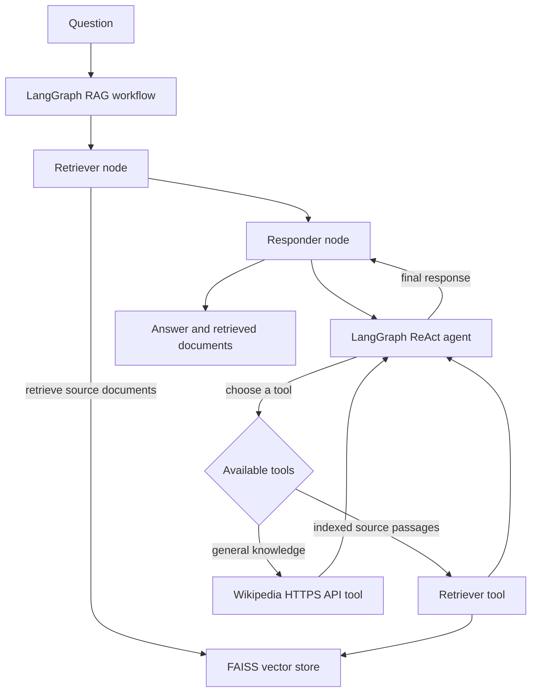

<div align="center">

# ContextIQ

### Agentic RAG with local-first embeddings and Groq-powered answers


</div>

ContextIQ answers questions using your indexed documents and web sources. It
combines FAISS retrieval, local `sentence-transformers/all-MiniLM-L6-v2`
embeddings, a Groq chat model, and a ReAct agent with retrieval and Wikipedia
tools.

## Features

- **Groq chat model:** configured with `GROQ_API_KEY`; defaults to
  `qwen/qwen3.8-27b`.
- **Local embeddings:** `sentence-transformers/all-MiniLM-L6-v2` runs on your
  machine through `HuggingFaceEmbeddings`. Embedding requests do not use an
  OpenAI API key or a hosted embedding API.
- **FAISS retrieval:** creates an in-memory vector index from processed
  document chunks.
- **ReAct tool agent:** the chat model can choose between searching the indexed
  documents and looking up general information through Wikipedia's HTTPS API.
- **Two ways to run:** a Streamlit interface or the command-line application.

Groq chat completions and source downloads require an internet connection. On
first start, Hugging Face downloads the embedding model, which is then run
locally.

## Requirements

- Python 3.13 or newer
- [uv](https://docs.astral.sh/uv/) (recommended), or Python's `venv` and `pip`
- A Groq API key
- Internet access for Groq, configured web sources, Wikipedia, and the initial
  embedding-model download

## Getting started

### 1. Clone the repository and install dependencies

Clone the project and enter its directory:

```powershell
git clone https://github.com/proindra/ContextIQ.git
cd ContextIQ
```

Install the locked dependencies:

```powershell
uv sync
```

`uv sync` creates `.venv` and installs the dependencies from `uv.lock`.

### 2. Configure Groq

Create your local environment file from the example:

```powershell
Copy-Item .env.example .env
```

Open `.env` and replace the placeholder with your Groq API key:

```env
GROQ_API_KEY=your_groq_api_key
GROQ_MODEL=qwen/qwen3.8-27b
USER_AGENT=AgenticRAG/0.1 (contact: you@example.com)
```

`GROQ_API_KEY` is required. `GROQ_MODEL` is optional; if omitted, the
application uses `qwen/qwen3.8-27b`. Set it to a model ID currently available
to your Groq account. `USER_AGENT` identifies requests made to web sources;
the application supplies `AgenticRAG/0.1` if it is omitted.

Keep `.env` private. It is excluded from Git; commit `.env.example`, not your
personal `.env` file.

### 3. Run the Streamlit app

```powershell
uv run streamlit run streamlit_app.py
```

Open the local URL printed by Streamlit (usually `http://localhost:8501`). The
first initialization may take longer while the embedding model is downloaded
and the document index is built. Ask a question in the search box; the app
shows the answer and retrieved source passages.

### Run the command-line app instead

```powershell
uv run python main.py
```

The CLI initializes the same RAG components, runs its example questions, and
offers an interactive prompt. Type `quit`, `exit`, or `q` to leave interactive
mode.

## ReAct architecture



The request follows these steps:

1. **Load and split sources.** `DocumentProcessor` loads the configured web
   pages and PDFs in `data/`, then splits document text into chunks (500
   characters with 50 characters of overlap by default).
2. **Embed and index.** `VectorStore` embeds the chunks using
   `sentence-transformers/all-MiniLM-L6-v2` and creates a FAISS index in memory.
3. **Run the outer graph.** `GraphBuilder` defines a LangGraph workflow with a
   `retriever` node followed by a `responder` node. The retriever node fetches
   relevant documents for the question and keeps them in the graph state.
4. **Use the ReAct agent.** The responder runs a LangGraph prebuilt ReAct agent
   with two tools:
   - `retriever` searches the indexed corpus for passages relevant to a query.
   - `wikipedia` searches Wikipedia and returns article extracts over HTTPS.
5. **Return results.** The agent returns a final answer. The graph state also
   contains the question and documents from the outer retriever node; the
   Streamlit UI displays those documents as sources.

The graph state is defined in `src/state/rag_state.py`. The graph and agent are
implemented in `src/graph_builder/graph_builder.py` and
`src/node/reactnode.py`. Model configuration is in `src/config/config.py`.

The FAISS index is rebuilt when the app initializes; it is not persisted between
process runs. Streamlit caches the initialized RAG graph for the current app
process.

## Sources and configuration

The default web pages are listed in `Config.DEFAULT_URLS` in
`src/config/config.py`. Adjust this list to index other web pages. PDF documents
placed in `data/` are also loaded by the document processor. After changing
sources, restart the app so its index is rebuilt.

Chunk sizing is controlled by `Config.CHUNK_SIZE` and `Config.CHUNK_OVERLAP`.
The embedding model is configured in `src/vectorstore/vectorstore.py`.

## Troubleshooting

- **Missing API key:** confirm `.env` exists beside `pyproject.toml` and has a
  non-empty `GROQ_API_KEY`.
- **Model not found or no access (Groq 404):** set `GROQ_MODEL` to an active
  model ID available to your Groq account, then restart Streamlit.
- **Slow first startup:** the embedding model must be downloaded once. Later
  starts use the local Hugging Face cache.
- **Source or Wikipedia request errors:** check your internet connection and
  try again. Wikipedia requests use the public English Wikipedia API.
- **Changed environment variables:** restart the Streamlit process after
  editing `.env`.

## Dependency management

After changing dependencies in `pyproject.toml`, refresh and install them with:

```powershell
uv lock
uv sync
```

`requirements.txt` is also provided for pip-based installations.
